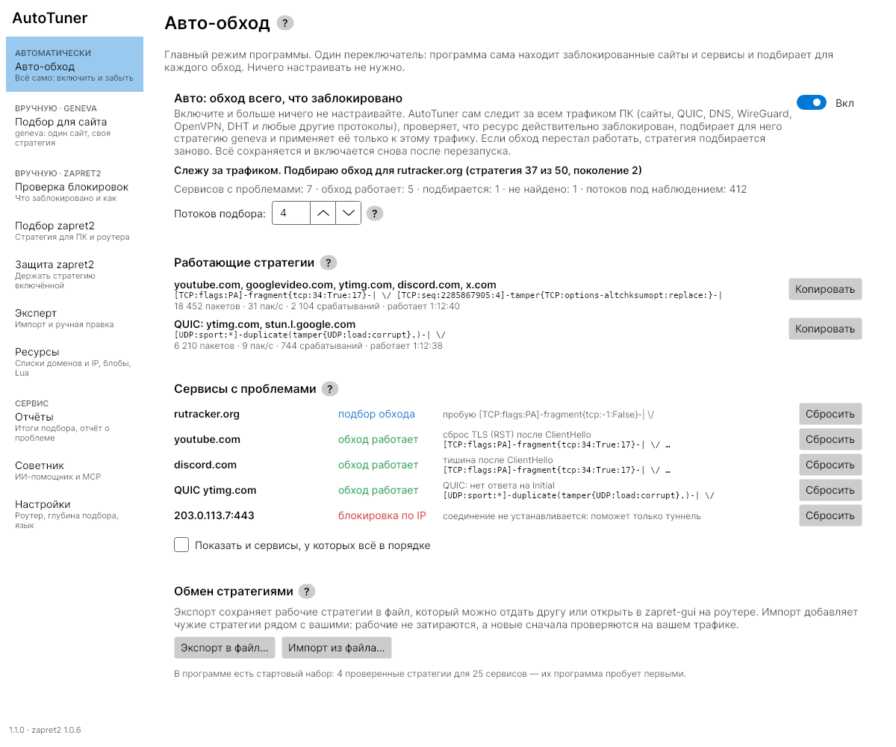
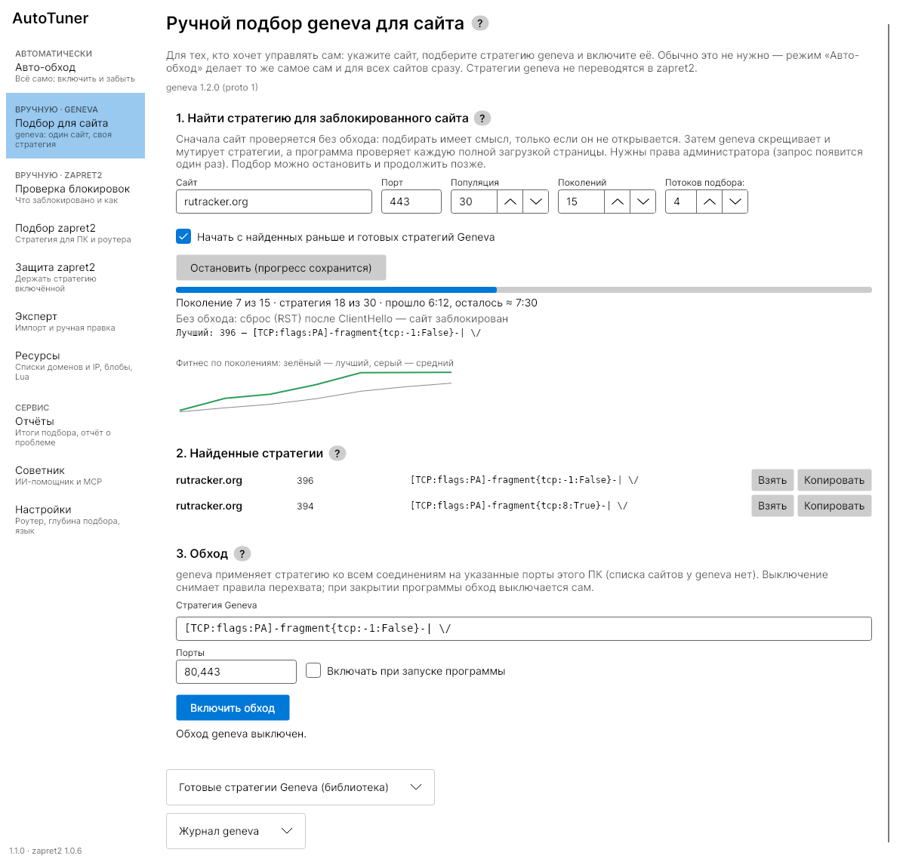
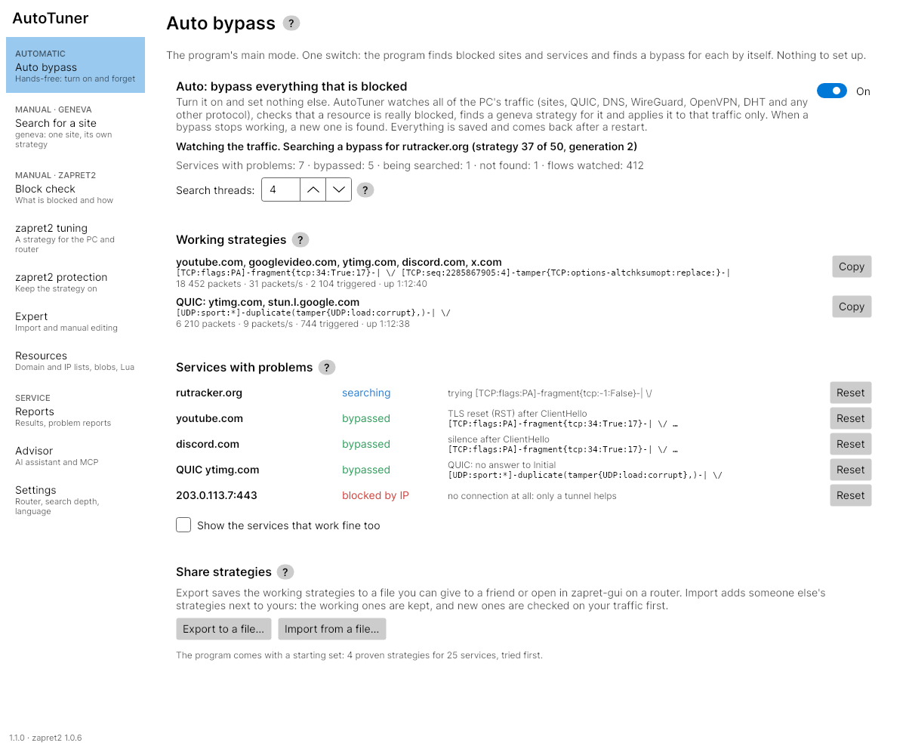

# Zapret2_AutoTuner

> [!IMPORTANT]
> Данный материал подготовлен в научно-технических целях.
> Использование предоставленных материалов в целях отличных от ознакомления может являться нарушением действующего законодательства.
> Автор не несет ответственности за неправомерное использование данного материала.

> [!WARNING]
> **Вы пользуетесь этой инструкцией на свой страх и риск!**
> 
> Автор не несёт ответственности за порчу оборудования и программного обеспечения, проблемы с доступом и потенцией.
> Подразумевается, что вы понимаете, что вы делаете.

---

Кроссплатформенное (Windows, Linux) приложение на C# для обхода блокировок на
ПК. Два движка: [geneva_c](https://github.com/avatarDD/geneva_c) (C-порт
Geneva, режим «Авто») и [zapret2](https://github.com/bol-van/zapret2)
(nfqws2 / winws2). Каждая найденная стратегия проверяется полной загрузкой
страницы во встроенном браузере. Стратегии zapret2 экспортируются в zapret2,
[nfqws2-keenetic](https://github.com/nfqws/nfqws2-keenetic) и
[zapret-gui](https://github.com/avatarDD/zapret-gui), стратегии geneva — в
zapret-gui.

Скачать — [релизы](https://github.com/avatarDD/Zapret2_AutoTuner/releases)
(Windows: установщик и portable zip; Linux x64/arm64: .deb, .rpm, tar.gz).
Как пользоваться — [docs/USER.md](docs/USER.md). План — [docs/PLAN.md](docs/PLAN.md). Правила для разработки — [AGENTS.md](AGENTS.md).

## Авто-обход (geneva)

Главный режим, с него открывается программа. Один переключатель: AutoTuner
сам следит за трафиком ПК (сайты, QUIC, DNS, WireGuard, OpenVPN, DHT и любые
другие протоколы), замечает сервисы, соединения с которыми рвёт DPI, и
подбирает каждому стратегию [geneva_c](https://github.com/avatarDD/geneva_c).



- **Только заблокированное.** Сервис сначала проверяется без обхода
  (baseline); найденная стратегия применяется только к его адресам и портам,
  остальной трафик через geneva не идёт.
- **Сначала готовое.** Сперва пробуются стратегии, которые уже работают для
  других сервисов, стартовый набор (проверенные стратегии для YouTube,
  Discord, X, Google и других) и импортированные, и только потом —
  генетический подбор. Два пустых подбора подряд — следующий идёт шире.
- **Потоки подбора 1–8.** Несколько стратегий проверяются одновременно
  (нужна geneva_c 1.2 или новее, она уже в бандле).
- **Обмен стратегиями.** Экспорт и импорт в формате zapret-gui
  (`zapret-gui/geneva-strategies`): файл из AutoTuner открывается в
  zapret-gui на роутере и наоборот. Адреса пользователя в файл не попадают.
- **Сам по себе.** Режим включается снова после перезапуска, окно
  сворачивается в трей; «Выход» в меню значка снимает обход.

Для одного сайта есть ручной подбор geneva: поколения, лучший результат и
график, найденные стратегии и включение обхода с живыми счётчиками.



Меню разделено на «Автоматически», «Вручную · geneva», «Вручную · zapret2»
(проверка блокировок, подбор и защита zapret2, эксперт, ресурсы) и «Сервис»
(отчёты, советник с MCP, настройки). Все данные лежат в папке `data` рядом с
программой; данные прежних версий переносятся туда сами
([docs/USER.md](docs/USER.md), «Где хранятся данные»).

## Auto bypass (English)

The main mode: one switch, and AutoTuner watches the PC's traffic, notices
services that DPI breaks, checks each without a bypass first, tries the
strategies that already work and the built-in starting set, and only then runs
a genetic search with [geneva_c](https://github.com/avatarDD/geneva_c) (1–8
search threads). A strategy applies to its service's traffic only. Strategies
are shared in zapret-gui's format. The English guide is the second half of
[docs/USER.md](docs/USER.md).



## Сборка

Нужны .NET SDK 10 и Python 3 (для скрипта бандла).

```sh
dotnet build ZapretAutoTuner.slnx
dotnet test ZapretAutoTuner.slnx
# движки закреплённых версий для своей платформы
python3 tools/bundle/bundle.py --rid linux-x64          # zapret2; или win-x64, linux-arm64
python3 tools/bundle/bundle_geneva.py --rid linux-x64   # geneva_c (tools/bundle/geneva.lock.json)
dotnet publish src/ZapretAutoTuner.App -c Release -r linux-x64 --self-contained -o out
dotnet publish src/ZapretAutoTuner.Agent -c Release -r linux-x64 --self-contained -o out
```

Интеграционные тесты (настоящий движок через Agent) требуют прав root на
Linux (network namespace, nft/iptables) или администратора на Windows
(WinDivert). Без прав они пропускаются, в CI идут в отдельной джобе:

```sh
sudo -E env "PATH=$PATH" ZT_ZAPRET2_DIR=$PWD/runtimes/linux-x64/zapret2 \
  dotnet test tests/ZapretAutoTuner.Agent.Tests
```

Если Agent упал и оставил правила firewall, их снимает
`sudo ztuner-agent --cleanup --data-dir=<каталог данных>`.

## Структура

| Путь | Что |
|---|---|
| `src/ZapretAutoTuner.Core` | модель, каталог функций zapret2, генератор, валидатор, экспорт; `Geneva/` — модель geneva, режим «Авто», обмен стратегиями и стартовый набор (`Geneva/Data/geneva-preset.json`) |
| `src/ZapretAutoTuner.Tuning` | подбор zapret2, защита и починка; `Geneva/` — подбор и обход geneva, контроллер «Авто» |
| `src/ZapretAutoTuner.Storage`, `Delivery`, `Mcp` | база знаний (SQLite), доставка на роутер и в zapret-gui, MCP-сервер |
| `src/ZapretAutoTuner.Agent` | привилегированный помощник: движок, firewall, захват |
| `src/ZapretAutoTuner.Protocol` | gRPC-контракт UI ↔ Agent |
| `src/ZapretAutoTuner.Probes` | пробы: DNS, curl, браузер |
| `src/ZapretAutoTuner.Tools` | бандл zapret2 и внешние инструменты |
| `src/ZapretAutoTuner.App` | интерфейс (Avalonia) |
| `src/ZapretAutoTuner.Bench` | `ztuner-bench`: замер «испытаний до успеха» на симулированных DPI (статический порядок, бандит, модель; PLAN 4a.3) |
| `third_party/zapret2` | lua, `protocol.c` и `nfqws.c` бандлимой версии zapret2 (MIT), с ними сверяется каталог |
| `tools/bundle` | скачивание и проверка закреплённых релизов zapret2 и geneva_c (`*.lock.json`, `update_geneva_lock.py`) |
| `docs/img` | скриншоты для README |
| `tests/pcaps`, `tools/pcaps` | корпус пакетов и эталон tshark для разбора TLS, JA4, QUIC, RST |

## Релиз

Тег `v1.2.3` запускает `.github/workflows/release.yml`: тесты на Windows и
Linux, бандл zapret2 по закреплённому SHA-256, бандл последнего релиза
geneva_c (сверяется с его `SHA256SUMS`), self-contained publish, пакеты
(Windows: установщик Inno Setup и portable zip; Linux x64/arm64: .deb, .rpm,
tar.gz), `SHA256SUMS.txt` и GitHub-релиз. Пакеты сразу загружаются в
черновик релиза, а не в артефакты Actions, поэтому квота хранилища артефактов
сборке не мешает. AppImage в релизе 1 нет (см. `docs/PLAN.md`, фаза 9).
Ручной запуск (workflow_dispatch) собирает пакеты без релиза; с галочкой
«publish» он выпускает релиз `v<версия>` и сам создаёт тег на текущем коммите,
если тега ещё нет.

Телеметрии нет и при сборке: статистика Avalonia.BuildServices отключена в
`Directory.Build.targets`.
