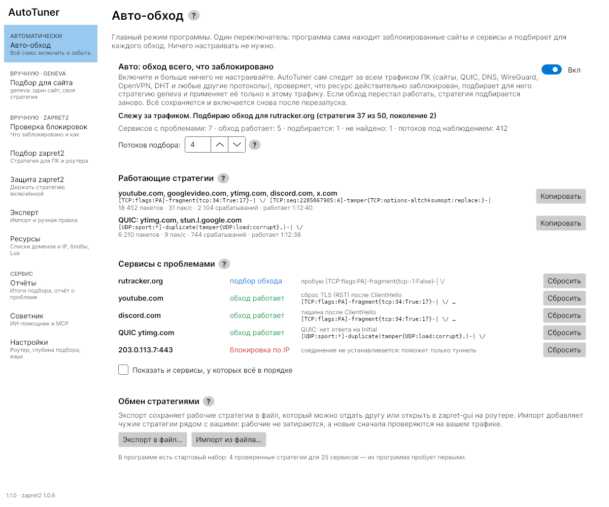
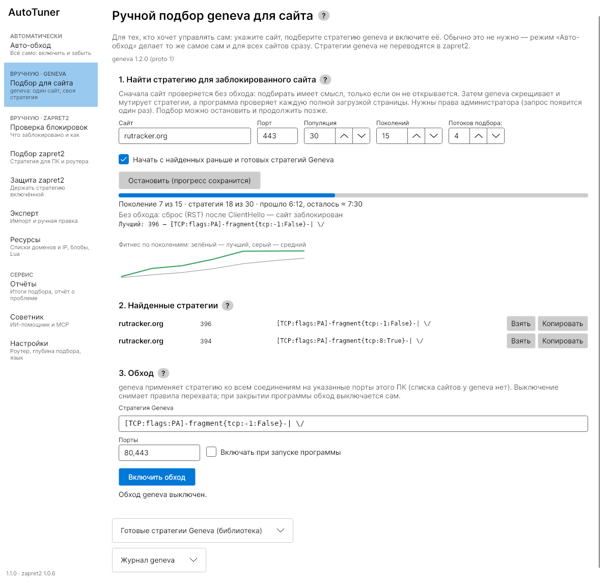
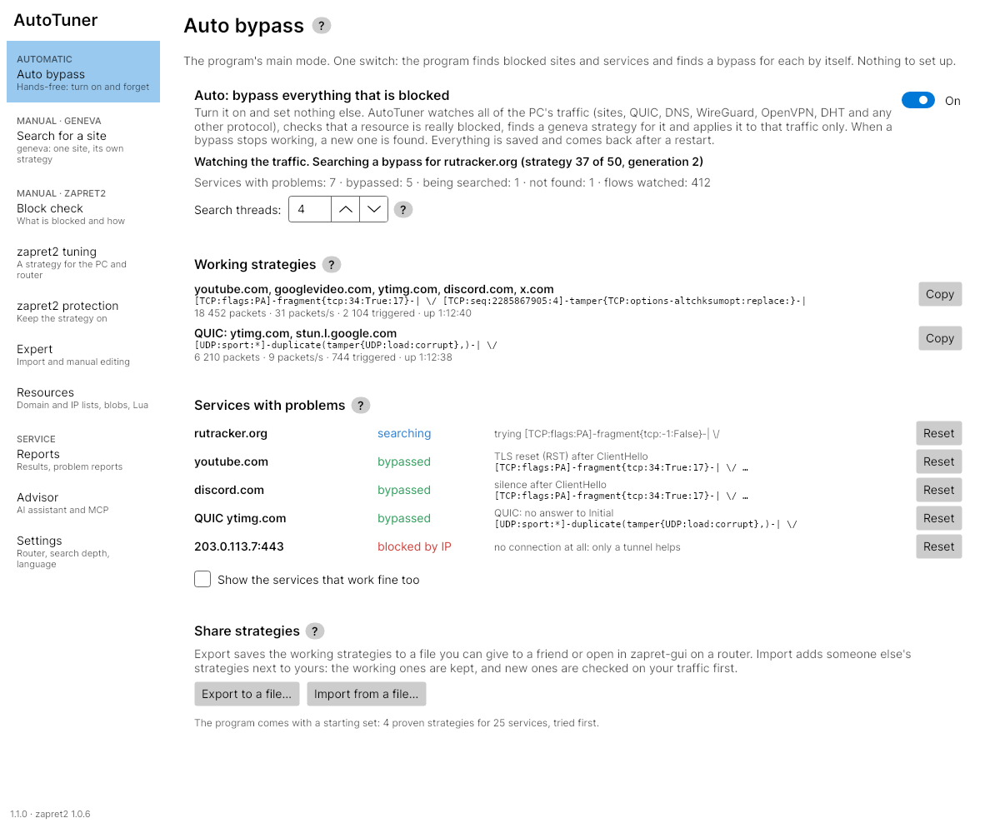

# Zapret2 AutoTuner — руководство пользователя

*English version below.*

## Установка

- **Windows 10/11 x64:** `ZapretAutoTuner-<версия>-win-x64-setup.exe` или
  portable-архив `…-portable.zip` (распаковать и запустить `ZapretAutoTuner.exe`).
- **Linux x64 и arm64:** `.deb` (Debian, Ubuntu), `.rpm` (Fedora, openSUSE)
  или `.tar.gz`. Нужны nftables (или iptables) и polkit (`pkexec`). AppImage
  нет: агент с правами root не может запуститься из её FUSE-образа.

Файлы можно сверить с `SHA256SUMS.txt` из релиза. Движки внутри —
официальные сборки без изменений: zapret2 из релиза bol-van/zapret2 и
geneva_c из релиза avatarDD/geneva_c (с WinDivert из релиза его автора).

**Права администратора и portable-архивы.** Агент запускает движок с правами
администратора (root). Безопаснее всего установщик, `.deb` или `.rpm`: они кладут
программу в каталог, который могут менять только администраторы. Portable-архив
(`.zip`, `.tar.gz`) распакуйте в такую же папку (например, `C:\Program Files\…`
или `/opt/…` с владельцем root), а не в «Загрузки» или домашний каталог. Если папка
движка доступна на запись обычному пользователю, агент запускает движок только из
своей защищённой копии, сверенной с `bundle.json`, и отказывает при расхождении,
но сам файл агента так защитить нельзя: подменённый агент получит права при
следующем запуске.

## Как пользоваться

Меню разделено на три части: **«Автоматически»** (главный режим, подходит
почти всем), **«Вручную · geneva»** и **«Вручную · zapret2»** (свой подбор под
конкретный сайт или роутер) и **«Сервис»**. У разделов и важных настроек есть
кнопка «?» — короткая подсказка с примером.

### Авто-обход (главный режим)

Программа открывается на странице «Авто-обход». Включите переключатель — и
больше ничего настраивать не нужно. Один раз появится запрос прав
администратора.

Программа сама следит за всем трафиком ПК: сайтами (TCP и QUIC), DNS,
WireGuard, OpenVPN, DHT торрентов и любыми другими протоколами. Если
соединения с каким-то сервисом рвутся так, как это делает DPI, программа
сначала проверяет его без обхода: обход ищется, только если сервис
действительно заблокирован. Потом она пробует готовые стратегии: сначала
те, что уже работают для других сервисов, и стартовый набор (проверенные
стратегии для YouTube, Discord, X, Google и других сайтов — первые сайты
обычно открываются за минуту-две), и только если они не помогают, запускает
генетический подбор geneva. Если два подбора подряд ничего не нашли,
следующий идёт шире: больше стратегий из библиотеки, вдвое большая
популяция и подмена не только TCP, но и IP-заголовков.

Найденная стратегия применяется только к трафику этого сервиса (его адресам
и портам, а для торрента — его локальному порту), остальной трафик через
geneva не идёт. Если обход перестал работать, стратегия подбирается заново.
Если заблокирован сам адрес (соединение не устанавливается вовсе),
программа так и пишет: здесь поможет только туннель.

- **«Работающие стратегии».** Одна стратегия часто подходит многим сайтам,
  поэтому они объединяются в группы: одна строка — одна стратегия и все её
  сервисы. Новые сервисы сначала пробуют стратегии этих групп.
- **«Сервисы».** Состояние каждого сервиса с проблемой и кнопка «Сбросить».
- **«Потоков подбора».** Сколько стратегий проверяется одновременно (1–8).
  Больше потоков — быстрее подбор, но больше соединений к сайту. Нужна
  geneva_c 1.2 или новее; со старой версией подбор идёт в один поток, и
  программа об этом пишет.
- **«Обмен стратегиями».** «Экспорт в файл…» сохраняет рабочие стратегии с
  именами сервисов (домен или протокол, ваши адреса в файл не попадают).
  Формат тот же, что у zapret-gui (`zapret-gui/geneva-strategies`, JSON),
  поэтому файл открывается и в zapret-gui на роутере. «Импорт из файла…»
  принимает такой же файл или простой текст — одна стратегия на строку.
  Импортированные стратегии добавляются рядом с вашими: рабочие не
  затираются, а новые проверяются (`geneva check`) и пробуются на вашем
  трафике так же, как стартовый набор.

Режим остаётся включённым после перезапуска. Окно можно свернуть в трей
(значок у часов): обход работает, пока программа запущена, а «Выход» в меню
значка закрывает программу и снимает обход. На Windows для применения
найденных стратегий нужна geneva_c 1.1 или новее.

### Вручную

1. **Проверка блокировок → «Проверить блокировки».** Программа проверит популярные сайты и
   покажет светофор: зелёный — работает, жёлтый — частично, красный — блок.
2. **Подбор zapret2.** Впишите сайты (или нажмите готовый набор:
   YouTube, Discord, Telegram, Instagram) и нажмите «Начать». Программа
   определит тип блокировки, переберёт стратегии и проверит найденное полной
   загрузкой. Видно этап, процент, прошедшее и оставшееся время. Подбор
   можно остановить в любой момент («Остановить» берёт лучшее найденное) или
   поставить на паузу: текущая проба доработает, и движок остановится.
   Проверенное сохраняется по ходу, поэтому после паузы, закрытия программы
   или перезагрузки компьютера на первом шаге будет кнопка «Продолжить
   подбор»: уже проверенные стратегии заново не запускаются.
   Найденное перепроверяется в конце: пять полных загрузок (одна случайная
   неудача допускается) и, с галочкой браузера, открытие страницы. Если
   странице нужны другие домены (CDN, картинки), программа назовёт их:
   добавьте их отдельными целями, стратегия для основного сайта при этом
   сохраняется.
3. **«Где включить».** Найденная стратегия сама по себе нигде не работает:
   программа хранит её у себя (файл `current-solution.json` в папке данных,
   переживает перезапуск, в «Проверке блокировок» есть кнопка «Где включить…»). Дальше
   выберите одно место, на каждой карточке написано, куда попадёт стратегия
   и как она включается:
   - **Этот компьютер.** «Включить на этом компьютере» запускает встроенный
     zapret2 и открывает «Защиту zapret2»; обход работает, пока открыт AutoTuner.
     В Windows есть «Установить как службу Windows» (служба `zt_winws2`
     работает и без AutoTuner, с загрузки) и «Удалить службу Windows». Ещё
     можно сохранить архив для своего zapret2/winws2.
   - **Keenetic (nfqws2-keenetic).** «Установить на роутер по SSH»: в
     `/opt/etc/nfqws2/nfqws2.conf` заменяются только переменные стратегии
     (с резервной копией), домены дописываются в `lists/user.list`, потом
     nfqws2 перезапускается. Или «Сохранить архив» с README.
   - **zapret-gui.** «Отправить в zapret-gui» сохраняет стратегию
     «AutoTuner: <сайты>» в разделе «Стратегии», применение — отдельный
     вопрос. Или архив для «Стратегии → Импорт».
   - **Другие системы:** архив для zapret2 на Linux/OpenWrt
     (`/opt/zapret2/config`) и строка аргументов.
   Ничего не устанавливается и не применяется без вашего «Да».
4. **Защита zapret2.** «Включить защиту» держит стратегию запущенной и следит за её
   сайтами. Если сайт перестал открываться, программа ищет исправление и
   спрашивает, применить ли его (или применяет сама, если вы это разрешили в
   настройках). Кнопка «Не работает сейчас» запускает починку сразу.
5. **Отчёты.** Если подобрать не вышло, «Собрать отчёт» сохранит архив для
   разбора: ваши IP скрыты, домены можно скрыть галочкой. Есть готовый промт
   для Claude. Ничего не отправляется само.
6. **Эксперт.** Импорт чужой стратегии (config zapret2, nfqws2.conf, .cmd
   winws2, строка аргументов, JSON zapret-gui) с проверкой и использованием.
   Если стратегия ссылается на файл списка, которого нет рядом (например
   `--hostlist=C:\zapret\lists\list-general.txt`), программа берёт список
   из «Ресурсов» с тем же именем (`list-general`).
7. **Ресурсы.** Свои хостлисты, ipset'ы, блобы и Lua-скрипты. Имя можно
   ввести с расширением: «youtube.txt» сохранится как «youtube».
8. **Подбор для сайта (geneva вручную).** Свой подбор geneva для одного
   сайта в три шага: «Подбор» — генетический поиск стратегии для
   заблокированного сайта (каждую стратегию программа проверяет полной
   загрузкой страницы, видно поколение, процент, лучший результат и график;
   число потоков настраивается так же, как в «Авто»); «Найденные» —
   стратегии, с которыми сайт загрузился; «Обход» — включение выбранной
   стратегии с живыми счётчиками пакетов и срабатываний. Прогресс подбора,
   найденное и включённый обход сохраняются: остановленный подбор
   продолжается кнопкой «Продолжить», а обход с галочкой «Включать при
   запуске» возвращается после перезапуска программы. Одновременно работает
   только один движок: geneva (авто или вручную) или zapret2.

   

Под каждым пунктом меню написано, для чего он. При закрытии программы
вместе с ней завершаются все запущенные ею процессы (браузер проверки и
другие), агент сам останавливает движок и снимает правила.

Права администратора нужны только агенту, который запускает движок и правила
firewall; окно программы работает без них. При выходе агент снимает все свои
правила.

## Чат claude.ai через расширение браузера (мост MCP)

claude.ai не может сам достучаться до программ на вашем ПК и до роутера за
NAT. Мостом служит стороннее расширение браузера, которое умеет подключать
MCP-серверы к веб-чату, а AutoTuner — MCP-сервер, к которому оно
подключается. Цепочка: claude.ai → расширение → AutoTuner (127.0.0.1) →
zapret-gui на роутере (например, 192.168.2.1).

1. **Настройки → MCP-сервер:** включите сервер и «Streamable HTTP на
   127.0.0.1». Отметьте нужные разрешения (чтение доступно всегда).
2. **Раздел «Мост для расширения браузера»:**
   - `router_proxy` — чтобы в чате были инструменты zapret-gui роутера (с
     префиксом `gui_`). Нужны адрес и MCP-токен zapret-gui выше; модель их не
     видит. Всё, что zapret-gui не помечает как «только чтение», перед
     выполнением спросит вас в окне AutoTuner с именем инструмента и
     аргументами. Пока AutoTuner сам ставит эксперимент на роутере, такие
     инструменты ждут.
   - Если расширение подключается к AutoTuner напрямую, впишите его Origin
     (`chrome-extension://<id>` — id виден на странице `chrome://extensions`,
     `moz-extension://<uuid>` в Firefox). Остальные сайты и расширения
     получают отказ (403). Токен нужен всегда.
   - Скопируйте готовый фрагмент настройки: URL и заголовок
     `Authorization: Bearer <токен>` (галочка «Показать токен» подставит его).
3. **MCP-SuperAssistant** (расширение с открытым кодом) обычно работает
   через свой локальный прокси `npx @srbhptl39/mcp-superassistant-proxy
   --config mcpconfig.json` (по умолчанию `http://localhost:3006/sse`; в
   расширении укажите адрес прокси). В `mcpconfig.json` добавьте один из
   фрагментов из настроек: через stdio (`ZapretAutoTuner mcp` — подключится
   к уже открытому окну) или через HTTP с заголовком `Authorization`. Прокси
   ходит без Origin, поэтому список разрешённых расширений ему не нужен.
   Внимание: в README проекта (на момент написания) claude.ai нет в списке
   поддерживаемых сайтов — проверьте актуальную версию или используйте форк,
   который его поддерживает.
4. **Другие расширения-мосты** (например, форки «MCP Bridge for Claude.ai»,
   «Claude MCP Client / Injector») подключаются так же: тот же URL
   (Streamable HTTP `/mcp` или legacy SSE `/mcp/sse`) и тот же заголовок.
   Расширение должно уметь отправлять заголовок `Authorization`. Совместимость
   с конкретными расширениями мы не проверяли.

Безопасность: стороннее расширение видит весь обмен, а ответы роутера уходят
в чат claude.ai (адреса в них замаскированы). Подключайте только то
расширение, которому доверяете. Каждый вызов записывается в журнал MCP и
попадает в «Собрать отчёт»; кнопка «Остановить» на баннере обрывает и мост.

## Частые вопросы

**Антивирус ругается на WinDivert / winws2.** WinDivert — драйвер перехвата
пакетов, на котором работает zapret2 в Windows. Антивирусы часто помечают
его как «потенциально нежелательный» из-за самой возможности перехвата.
Файлы в релизе — официальные из bol-van/zapret2, хэш закреплён в
`tools/bundle/zapret2.lock.json`. Добавьте папку программы в исключения.

**VirtualBox / VMware в режиме NAT.** Внутри виртуалки с NAT стратегии,
завязанные на TTL, ведут себя иначе, чем на реальном ПК, а часть пакетов
переписывает сама виртуальная сеть. Подбирайте на реальной машине или в
режиме сетевого моста (bridge).

**Linux: «не найден pkexec».** Установите polkit (`policykit-1` или
`polkit`) или запустите программу от root.

**Проверка в браузере.** Галочка «Проверять найденное в браузере» открывает
сайт во встроенном браузере программы: Chromium без окна из Playwright в
папке `browsers` рядом с программой, каждый раз с чистым временным профилем.
Установленные у вас браузеры, их профили и настройки программа не трогает.
Если папки `browsers` нет, проверка идёт загрузкой страницы самой программой.

**Где хранятся данные.** Всё в одной папке `data` рядом с программой:
настройки, база найденных стратегий, импортированные стратегии, журналы и
экспорт. Portable-копию можно переносить вместе с этой папкой. Данные из
старого места (`%LOCALAPPDATA%\ZapretAutoTuner`, `~/.local/share/ZapretAutoTuner`)
при первом запуске переносятся сюда сами. Если папка `data` уже есть (новая версия
уже запускалась), найденные стратегии geneva, импортированные стратегии и
недостающие настройки старой базы добавляются к новой, а старая база
остаётся на месте под именем `knowledge.db.merged-<дата>`. Если в папку программы писать
нельзя (установка в `C:\Program Files`, `/opt` с владельцем root), данные
остаются в старом месте; запуск «от имени администратора» их тоже не
переносит. Свою папку можно задать переменной `ZT_DATA_DIR`.
Состояние агента с правами администратора хранится отдельно, в защищённой
папке (`C:\ProgramData\ZapretAutoTuner-*`, `/var/lib/zapret-autotuner`):
то, что запускается с правами, не должно лежать там, где его может
подменить обычный пользователь.

**Трей.** В Windows свёрнутое окно по умолчанию уходит в трей. В настройках
можно включить и закрытие окна в трей; тогда программа завершается только
через «Выход» в меню значка.

**Телеметрия.** Её нет. Настройки, база знаний и журнал хранятся только
локально (путь показан в настройках).

---

# Zapret2 AutoTuner — user guide

## Install

- **Windows 10/11 x64:** the `…-setup.exe` installer or the `…-portable.zip`.
- **Linux x64 and arm64:** `.deb`, `.rpm` or `.tar.gz`. Needs nftables (or
  iptables) and polkit (`pkexec`). There is no AppImage: the root agent cannot
  start from its FUSE mount.

Check files against `SHA256SUMS.txt`. The bundled engines are unmodified
official builds: zapret2 from bol-van/zapret2's release and geneva_c from
avatarDD/geneva_c's release (with WinDivert from its author's release).

**Administrator rights and portable archives.** The agent runs the engine as
Administrator (root). The installer, `.deb` or `.rpm` are the safe choice: they put
the program into a folder only administrators can change. Unpack a portable archive
(`.zip`, `.tar.gz`) into such a folder too (for example `C:\Program Files\…`, or
`/opt/…` owned by root), not into Downloads or your home. When the engine folder is
writable by a normal user, the agent runs the engine only from its protected copy
verified against `bundle.json` and refuses on a mismatch, but the agent binary itself
cannot be protected that way: a replaced agent gets the rights on its next start.

## Use

The menu has three parts: **Automatic** (the main mode, fits almost everyone),
**Manual · geneva** and **Manual · zapret2** (your own search for one site or
the router) and **Service**. Sections and key settings have a "?" button with a
short hint and an example.

### Auto bypass (the main mode)

The program opens on the Auto bypass page. Turn the switch on and nothing else
needs setting; administrator rights are asked for once.

The program watches all of the PC's traffic: sites (TCP and QUIC), DNS,
WireGuard, OpenVPN, torrent DHT and any other protocol. When connections to a
service fail the way DPI makes them fail, it first checks the service without a
bypass: a bypass is searched only for what is really blocked. Then it tries
ready strategies first: the ones already working for other services and the
starting set (checked strategies for YouTube, Discord, X, Google and other
sites, so the first sites usually open within a minute or two). Only if none
helps does it run geneva's genetic search. After two empty searches the next one
goes wider: more strategies from the library, a population twice as big, and
IP headers tampered as well as TCP.

A strategy it finds applies to that service's traffic only (its addresses and
ports, or a torrent's local port); the rest of the traffic never goes through
geneva. When a bypass stops working, a new one is searched. When the address
itself is blocked (no connection at all), the program says so: only a tunnel
helps there.

- **Working strategies.** One strategy often suits many sites, so they are
  grouped: one row is one strategy with all its services. New services try
  these strategies first.
- **Services** shows each service with a problem and a Reset button.
- **Search threads** sets how many strategies are tried at once (1–8). More
  threads search faster but open more connections to the site. This needs
  geneva_c 1.2 or newer; with an older one the search runs in one thread and
  the program says so.
- **Share strategies.** "Export to a file…" saves the working strategies with
  the names of their services (a domain or a protocol, never your addresses).
  The format is zapret-gui's (`zapret-gui/geneva-strategies`, JSON), so
  zapret-gui on the router opens the file too. "Import from a file…" takes such
  a file or plain text, one strategy per line. Imported strategies are added
  next to yours: working ones are never replaced, and new ones are checked
  (`geneva check`) and tried on your traffic like the starting set.

The mode stays on across restarts. The window can be minimized to the tray: the
bypass works while the program runs, and Exit in the tray menu closes the
program and removes the bypass. On Windows, applying the strategies needs
geneva_c 1.1 or newer.

### Manual

1. **Block check → Check for blocks** shows what is blocked.
2. **zapret2 tuning:** enter sites or pick a ready set and press Start. You
   see the stage, percent, elapsed and remaining time. Stop any time (Stop takes
   the best found so far) or Pause: the current trial finishes and the engine
   stops. What was tried is saved as it goes, so after a pause, closing the
   program or restarting the computer the first step offers "Continue the
   search", and strategies already tried are not run again.
   What was found is checked again at the end: five full loads (one stray miss
   is allowed) and, with the browser box ticked, the page. When the page needs
   other domains (a CDN, images), the program names them: add them as targets
   of their own, the strategy for the main site is kept.
3. **Where to turn it on.** A found strategy works nowhere by itself: the app
   keeps it (`current-solution.json` in the data folder, it survives a restart;
   Block check has "Where to turn it on…"). Each card says where the strategy goes and
   how it is turned on: **this PC** (the built-in zapret2 while AutoTuner is
   open, a Windows service `zt_winws2` that runs without it, or an archive),
   **Keenetic** over SSH (only the strategy variables of `nfqws2.conf` are
   replaced, after a backup) or as an archive, **zapret-gui** (saved as an
   "AutoTuner: <sites>" strategy, applying is a separate question) or as an
   archive, and **other systems**: zapret2 on Linux/OpenWrt, an argument line.
   Nothing is installed or applied without your Yes.
4. **zapret2 protection** keeps the strategy running and repairs it when a site breaks,
   asking first unless you allowed automatic fixes.
5. **Reports** builds an archive for analysis with your IPs masked. Nothing is
   sent anywhere.
6. **Expert** imports and validates someone else's strategy. A list file the
   strategy names but that is not there (`--hostlist=C:\zapret\lists\list-general.txt`)
   is taken from Resources under the same name (`list-general`).
7. **Resources** keeps your hostlists, ipsets, blobs and Lua scripts. A name may
   have an extension: "youtube.txt" is saved as "youtube".
8. **Search for a site (manual geneva)** is your own geneva search for one
   site in three steps: Search (a genetic search for a blocked site, every
   strategy judged by a full page load, with the generation, percent, best
   result and a chart; threads are set as in Auto), Found (the strategies the
   site loaded with) and Bypass (turns the chosen strategy on, with live packet
   and trigger counters). Search progress, found strategies and the bypass are
   saved: Continue resumes a stopped search, and a bypass with "Turn on at
   start" comes back after the program restarts. Only one engine runs at a
   time: geneva (auto or manual) or zapret2.

Every menu item says what it is for. Closing the program ends every process it
started (the check's browser and others); the agent stops the engine and
removes its rules by itself.

Only the agent runs with administrator rights; it removes its firewall rules
on exit.

## The claude.ai chat through a browser extension (MCP bridge)

claude.ai cannot reach programs on your PC or a router behind NAT. A
third-party browser extension that connects MCP servers to the web chat is the
bridge, and AutoTuner is the MCP server it connects to: claude.ai → extension
→ AutoTuner (127.0.0.1) → zapret-gui on the router (e.g. 192.168.2.1).

1. **Settings → MCP server:** turn the server and "Streamable HTTP on
   127.0.0.1" on and pick the permissions (reading is always allowed).
2. **"Browser extension bridge":**
   - `router_proxy` puts the router's zapret-gui tools (prefix `gui_`) in the
     chat. It needs zapret-gui's address and MCP token above; the model never
     sees them. Anything zapret-gui does not mark read-only asks you in the
     AutoTuner window first, with the tool's name and arguments, and waits
     while AutoTuner runs its own experiment on the router.
   - If the extension connects to AutoTuner itself, add its Origin
     (`chrome-extension://<id>`, the id is on `chrome://extensions`;
     `moz-extension://<uuid>` in Firefox). Other sites and extensions get 403.
     The token is always required.
   - Copy the ready snippet: the URL and the `Authorization: Bearer <token>`
     header ("Show the token" fills it in).
3. **MCP-SuperAssistant** (open source) usually goes through its local proxy
   `npx @srbhptl39/mcp-superassistant-proxy --config mcpconfig.json` (default
   `http://localhost:3006/sse`; point the extension at the proxy). Add one of
   the snippets from Settings to `mcpconfig.json`: stdio (`ZapretAutoTuner
   mcp`, which joins the open window) or HTTP with the `Authorization`
   header. The proxy sends no Origin, so it needs no allowed-extension entry.
   Note: at the time of writing, the project's README does not list claude.ai
   among the supported sites; check the current version or use a fork that
   supports it.
4. **Other bridge extensions** (e.g. forks of "MCP Bridge for Claude.ai" or
   "Claude MCP Client / Injector") connect the same way: the same URL
   (Streamable HTTP `/mcp` or legacy SSE `/mcp/sse`) and the same header. The
   extension must be able to send the `Authorization` header. We have not
   tested specific extensions.

Security: the third-party extension sees all traffic, and the router's answers
go to the claude.ai chat (with addresses masked). Connect only an extension you
trust. Every call is logged in the MCP audit and goes into "Collect report";
Stop on the banner cuts the bridge too.

## FAQ

- **Antivirus flags WinDivert:** it is zapret2's packet capture driver, the
  official file; add the program folder to exclusions.
- **VirtualBox NAT:** tune on the real machine or in bridged mode.
- **Linux "pkexec not found":** install polkit or run as root.
- **Browser check:** the site opens in the program's own browser (Playwright's
  headless Chromium in the `browsers` folder next to the program), with a fresh
  temporary profile each time. Your installed browsers, their profiles and
  settings are never touched. Without the `browsers` folder the program checks
  by loading the page itself.
- **Where the data lives:** all of it in one `data` folder next to the
  program: settings, the found strategies, imports, logs and exports, so a
  portable copy moves with it. Data from the old place
  (`%LOCALAPPDATA%\ZapretAutoTuner`, `~/.local/share/ZapretAutoTuner`) moves
  there at the first start. When a `data` folder is already there (this version ran
  before), the old base's geneva strategies, imports and missing settings are
  added to it, and the old base stays as `knowledge.db.merged-<date>`. When the program folder is not writable
  (`C:\Program Files`, a root-owned `/opt`), the data stays in the old place, and so does it on a "Run as
  administrator" start.
  `ZT_DATA_DIR` sets a folder of your own. The administrator agent keeps its
  state apart, in a protected folder (`C:\ProgramData\ZapretAutoTuner-*`,
  `/var/lib/zapret-autotuner`): what runs with admin rights must not live where
  a user can swap it.
- **Tray:** on Windows a minimized window goes to the tray by default; Settings
  can also make closing the window go to the tray, and then Exit in the tray
  menu closes the program.
- **No telemetry.** All data stays local.
